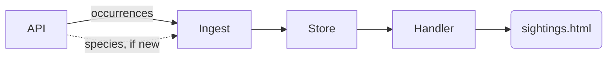

# Go - Domain Driven Design Layout

How do you lay out a Go project so the next person to open it knows where things are? (Or the next
agent, these days.) This repo is the code from my talks on that question: five folders, one app,
three questions. Open it in your editor and follow along.

## The app

I'm obsessed with anything in the ocean, so it's an animal sightings app. Every time someone spots
wildlife, it's recorded on [GBIF](https://www.gbif.org), a free API. We pull those sightings in,
store them and list them on a page.



Let's run one:

```sh
cd 01-flat    # or any of the five
go run .      # ingests 100 sightings from GBIF, then serves http://localhost:8080
```

You'll need Go 1.26 or newer. No dependencies, no API key, no database. Each folder is its own
module, `go.work` lets your editor jump between all five, and `make check` builds and vets them.

## Five folders, one app

Every folder builds the same app, laid out a different way:

| Folder                          | Organised by                       |
|---------------------------------|------------------------------------|
| [`01-flat`](01-flat/)           | Nothing. One package               |
| [`02-layered`](02-layered/)     | What the code does                 |
| [`03-onion`](03-onion/)         | Rings, with a domain in the middle |
| [`04-hexagonal`](04-hexagonal/) | A package per noun                 |
| [`05-feature`](05-feature/)     | The feature, all the way down      |

Keep these three questions in your head as you read each one:

1. Can you tell what it does?
2. Where does a new feature go?
3. Where do the rules live?

So which one wins? That's the talk.

## Where it goes next

`05-feature` stops at an in-memory map. The
[full sightings app](https://github.com/ainsleyclark/workshop-gophercon-africa-2026) takes the same
shape the rest of the way, with SQLite, sqlc and templ.

## Further reading

1. Eric Evans, [*Domain-Driven Design: Tackling Complexity in the Heart of
   Software*](https://www.domainlanguage.com/ddd/), 2003.

Come say hi at [ainsleyclark.com](https://ainsleyclark.com), and for more Go, check out
[godaily.dev](https://godaily.dev). [MIT](LICENSE) licensed.
